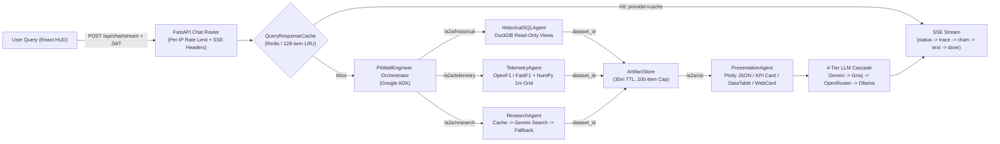

# PitWall AI — Formula 1 AI Race Engineer

**PitWall AI** is a full-stack Formula 1 AI Race Engineer application that answers natural-language questions spanning **1950 to 2024+**, delivering interactive `#0B0F17` telemetry HUD visualizations, corner-by-corner comparisons, tyre degradation models, grounded web research, and verifiable engineering provenance with **zero-hallucination math**.

---

## Core Design Principles

1. **Zero-Hallucination Math**: Every lap time, braking delta, corner minimum speed, win count, and tyre degradation slope is computed deterministically via **DuckDB SQL** or **Python/NumPy**—never from LLM parametric memory.
2. **Strict Data Domain Separation**:
   - **Historical Race Records (1950–2024+)**: Embedded read-only **DuckDB** (`data/f1_data.duckdb`) built from normalized Formula 1 datasets (`v_race_results`, `v_qualifying`, `v_pit_stops`, `v_driver_standings`, `v_constructor_standings`).
   - **Car Telemetry & Strategy (2023–present)**: **OpenF1 REST API** with persistent disk caching (`openf1_cache`), 1-meter spatial distance interpolation, and **FastF1** / local fixture fallback. Pre-2023 telemetry requests trigger an explicit domain-boundary explanation.
   - **Off-Dataset Rules & Incidents**: **Google Search Grounding** via Gemini with persistent disk caching (`data/research_cache/`).
3. **Provenance Transparency**: Every response includes a collapsible **Engineering Trace** showing A2A agent hops, `dataset_id`, provider used, latency, SQL query or telemetry/strategy parameters, and grounded source citations.
4. **Dark HUD Standards & Official Team Colors**: Visualizations render on `#0B0F17` with dynamic season-accurate F1 team colors.

---

## System Architecture & Request Workflow

PitWall AI uses a **Google ADK orchestrator** (`PitWallEngineer`) delegating over **Agent-to-Agent (A2A)** endpoints to four specialized agents, connected over Server-Sent Events (SSE) to a single-column React conversational HUD.



### Step-by-Step Execution Flow

1. **Authentication & Ingress**: Users authenticate via `/api/auth/login` (or `/api/auth/register`) to obtain a JWT token. Chat prompts hit `POST /api/chat/stream`, guarded by a per-IP 60s sliding-window rate limiter (`RATE_LIMIT_PER_MIN`, default `15`) and SSE anti-buffering headers (`Cache-Control: no-cache`, `Connection: keep-alive`, `X-Accel-Buffering: no`).
2. **Read-Through Query Cache**: Standalone queries are normalized and checked against `QueryResponseCache` (`REDIS_URL` if configured, or a 128-item in-memory TTL LRU cache). Repeat hits replay verified trace/charts/commentary immediately (`provider: "cache"`) without spending LLM quota or re-fetching telemetry. Follow-ups with contextual pronouns bypass the cache so multi-turn session state applies.
3. **Intent Routing & A2A Specialist Delegation**: `PitWallEngineer` (`backend/app/agent/orchestrator.py`) routes the question to the matching A2A specialist:
   - **`HistoricalSQLAgent` (`/a2a/historical`)**: Converts natural language into validated read-only DuckDB `SELECT`/`WITH` SQL, normalizes circuit/GP aliases (e.g., Brazil / São Paulo / Interlagos), and saves rows to `ArtifactStore`.
   - **`TelemetryAgent` (`/a2a/telemetry`)**: Resolves circuits and corner nicknames via `CircuitCornerEngine` (e.g., `130R` → Suzuka Turn 15; Copse ±200m corridor; `Eau Rouge`), aligns car channels onto a 1-meter grid, or computes clean-lap tyre stint degradation. Unknown corner nicknames auto-trigger self-healing discovery via `ResearchAgent.resolve_and_learn_corner`.
   - **`ResearchAgent` (`/a2a/research`)**: Checks seeded (`./data/research_cache/`) and runtime (`{CACHE_DIR}/research_cache`) disk caches first, then Gemini Google Search Grounding, then cloud/local fallbacks.
4. **Visualization Rendering (`PresentationAgent` `/a2a/viz`)**: Consumes only the compact `dataset_id` from `ArtifactStore` (30-minute TTL, 200-item eviction cap) and emits the right `#0B0F17` HUD artifact—never an empty Plotly grid:
   - `plotly_figure` (`corner_telemetry` + optional `track_minimap`, `full_lap` + `SectorSummaryBar`, `tyre_stints`, multi-row `historical_sql` bar/line charts)
   - `kpi_card` (single-row DuckDB lookups)
   - `data_table` (multi-row classifications/tables)
   - `web_intelligence_card` (grounded summaries, bullets, and external links)
5. **SSE Streaming Lifecycle**: Frames always stream in deterministic order (`session` → `status` → `trace` → `chart` → `text` chunks → `done`), rendered per turn in the React HUD (`Status Pill` → `Visual Artifact` + fullscreen modal → `Race Engineer Prose` → collapsed single-line `Engineering Trace` bar).

---

## 4-Tier Cascading LLM Failover

Both synchronous SQL/research generation (`generate_with_failover`) and async commentary streaming (`stream_with_failover`) in [`backend/app/llm/failover_client.py`](backend/app/llm/failover_client.py) cascade cleanly with **independent 60-second HTTP 429 circuit breakers** per cloud provider:

| Tier | Provider | Transport / Notes | Trace & Card Label |
| :--- | :--- | :--- | :--- |
| **1** | **Gemini** | Google AI Studio (`GEMINI_API_KEY` / `GOOGLE_API_KEY`) or Vertex AI; supports `google_search` grounding | `Google Search Grounding` / `DuckDB + Gemini` |
| **2** | **Groq** | `POST {GROQ_BASE_URL}/chat/completions` (`openai/gpt-oss-120b`, 30s timeout, prompt trimmed for 8K TPM) | `Groq Cloud Fallback — No Live Search` |
| **3** | **OpenRouter** | `POST {OPENROUTER_BASE_URL}/chat/completions` (`openrouter/free`, 35s timeout, `X-Title: PitWall AI`) | `OpenRouter Free Fallback — No Live Search` |
| **4** | **Local Ollama** | `http://127.0.0.1:11434/api/chat` (`qwen3.5:4b`, `think: false`, `num_ctx: 1024`, 150s timeout). Auto-disabled in `APP_ENV=production` | `Local Ollama Fallback — Offline Model` |

*(Cached responses always report `cache` / `Cached Search Grounding`.)*

---

## Repository Structure

```text
f1-race-engineer/
├── backend/
│   ├── app/
│   │   ├── main.py                     # FastAPI app, CORS, lifespan, /health & /api/health
│   │   ├── config.py                   # Pydantic settings (LLM cascade, CACHE_DIR, CORS, rate limit)
│   │   ├── auth/                       # JWT auth (/api/auth/login, /register, /me)
│   │   ├── chat/                       # POST /api/chat/stream (SSE + sliding-window rate limiter)
│   │   ├── cache/                      # QueryResponseCache (Redis / 128-item TTL LRU)
│   │   ├── llm/                        # 4-tier cascading failover & 429 circuit breakers
│   │   ├── agent/                      # Google ADK orchestrator & deterministic telemetry/strategy tools
│   │   ├── a2a/                        # A2A registry (/a2a/*), A2AClient, ArtifactStore, 4 specialist agents
│   │   ├── charts/                     # Dark HUD Plotly builders (#0B0F17)
│   │   └── data/                       # DuckDB manager, curated views, OpenF1 client, FastF1 Semaphore(2), CircuitCornerEngine
│   ├── tests/                          # Pytest suite (120 tests covering ingestion, SQL safety, telemetry, A2A, failover, deployment)
│   ├── pyproject.toml
│   └── requirements.txt
├── frontend/
│   ├── src/
│   │   ├── App.tsx                     # Single-column conversational HUD (+ New Session, auto-scroll, WelcomeHero)
│   │   ├── hooks/                      # useAuth, useSSEStream (per-turn chart/minimap/trace state)
│   │   ├── services/api.ts             # Dynamic API_BASE from VITE_API_URL
│   │   └── components/
│   │       ├── ChatPanel/              # WelcomeHero, TurnItem, MessageBubble, ComposerBar, PresetPrompts
│   │       ├── ChartStage/             # ChartStage (fullscreen modal), PlotlyChart, TrackMiniMap, SectorSummaryBar, KpiCard, DataTableCard, WebIntelligenceCard
│   │       ├── EngineeringTrace/       # Collapsible single-line TraceDrawer (A2A hops, provider, SQL/params, sources)
│   │       ├── MetadataBar/            # Event, session, corner, and official driver color badges
│   │       └── Auth/LoginPage.tsx
│   ├── .env.example
│   ├── vercel.json                     # SPA rewrite to /index.html
│   └── package.json
├── data/
│   ├── f1_data.duckdb                  # Pre-built embedded historical F1 database (1950–2024+)
│   ├── corner_nicknames.json           # Curated F1 corner nickname -> turn mappings
│   ├── research_cache/                 # Seeded grounded F1 web intelligence cache
│   └── fastf1_cache/                   # Offline verified Silverstone fixture
├── specs/001-pitwall-ai/               # Feature spec, architecture plan, data model, API contracts, tasks
├── Dockerfile                          # Python 3.11-slim non-root (uid=1000) image for HF Spaces / Cloud Run
└── .dockerignore
```

---

## Local Development Setup

### Prerequisites
- Python **3.11+** (3.12+ recommended)
- Node.js **20+** (`npm` or `pnpm`)
- Optional: [Ollama](https://ollama.com/) (`ollama pull qwen3.5:4b`) for local offline Tier 4 fallback

### 1. Configure Environment (`.env` at repo root)

Create `.env` in `f1-race-engineer/` (gitignored):

```env
# Tier 1: Gemini (AI Studio key; or Vertex AI vars in production)
GEMINI_API_KEY=your_gemini_api_key
GEMINI_MODEL=gemini-3.5-flash-lite
LLM_PROVIDER=gemini

# Optional Tier 2 & Tier 3 Cloud Fallbacks
GROQ_API_KEY=your_groq_api_key
GROQ_BASE_URL=https://api.groq.com/openai/v1
GROQ_MODEL=openai/gpt-oss-120b

OPENROUTER_API_KEY=your_openrouter_api_key
OPENROUTER_BASE_URL=https://openrouter.ai/api/v1
OPENROUTER_MODEL=openrouter/free

# Tier 4 Local Ollama (enabled automatically when APP_ENV=local)
APP_ENV=local
OLLAMA_MODEL=qwen3.5:4b
OLLAMA_API_BASE=http://127.0.0.1:11434
```

### 2. Run the Backend

From the repository root (`f1-race-engineer/`):

```bash
pip install -r backend/requirements.txt
uvicorn backend.app.main:app --reload --port 8000
```

Verify health check: `GET http://localhost:8000/health`

### 3. Run the Frontend

In a second terminal:

```bash
cd frontend
npm install
npm run dev
```

Open `http://localhost:5173`. Sign in with the seeded demo account or register a new user:
- **Demo Email**: `demo@pitwall.ai`
- **Demo Password**: `Pitwall2024!`

---

## Running Tests & Builds

```bash
# Backend full pytest suite (from repo root)
python -m pytest backend/tests/ -v

# Frontend TypeScript check + production bundle
cd frontend
npm run build
```

> **Note**: During `pytest`, live Gemini Search Grounding calls are automatically mocked via `backend/tests/conftest.py` to protect API quota. Set `RUN_LIVE_GROUNDING=1` to run live search grounding tests.

---

## Cloud Deployment ($0 Free Tier Target)

PitWall AI is containerized for stateless, zero-cost cloud hosting:

- **Backend (Hugging Face Spaces Docker or Google Cloud Run)**:
  - Root `Dockerfile` builds a Python 3.11-slim image running as non-root `uid=1000` on `0.0.0.0:${PORT:-7860}`.
  - Bundles embedded read-only `data/f1_data.duckdb`, `data/corner_nicknames.json`, and seeded `data/research_cache/`.
  - Sets `APP_ENV=production` (disabling `127.0.0.1:11434` Ollama probes) and `CACHE_DIR=/tmp/pitwall_cache` for writable runtime FastF1/research/artifact caches.
  - Set `CORS_ORIGINS=https://your-frontend.vercel.app`, LLM API keys, `JWT_SECRET`, and optionally `REDIS_URL` (Upstash Redis) in Space/Cloud Run secrets.
- **Frontend (Vercel or Cloudflare Pages)**:
  - Deploy `frontend/` with `VITE_API_URL=https://your-backend-url` (see `frontend/.env.example`).
  - `frontend/vercel.json` handles SPA catch-all routing to `/index.html`.
