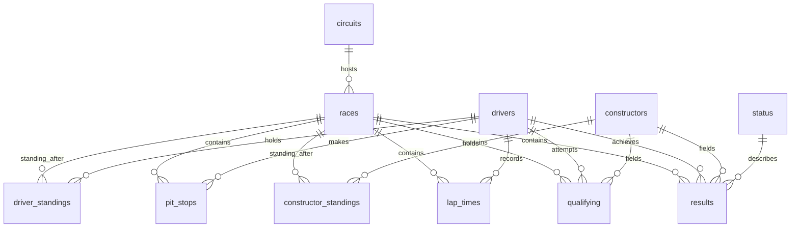

# Data Model: PitWall AI

**Feature**: 001-pitwall-ai | **Date**: 2026-11-22

## Domain 1: Historical Race Data (DuckDB)

Source: Kaggle F1 CSVs (Ergast-derived). Ingested at application startup with `\N` → NULL normalization.

### Source Tables (from CSV ingestion)

#### circuits

| Column | Type | Nullable | Description |
|--------|------|----------|-------------|
| circuitId | INTEGER | NO | Primary key |
| circuitRef | VARCHAR | NO | URL-safe identifier (e.g., "silverstone") |
| name | VARCHAR | NO | Full circuit name |
| location | VARCHAR | YES | City/locality |
| country | VARCHAR | YES | Country name |
| lat | DOUBLE | YES | Latitude |
| lng | DOUBLE | YES | Longitude |
| alt | INTEGER | YES | Altitude in meters |

#### constructors

| Column | Type | Nullable | Description |
|--------|------|----------|-------------|
| constructorId | INTEGER | NO | Primary key |
| constructorRef | VARCHAR | NO | URL-safe identifier |
| name | VARCHAR | NO | Constructor name |
| nationality | VARCHAR | YES | Country of origin |

#### drivers

| Column | Type | Nullable | Description |
|--------|------|----------|-------------|
| driverId | INTEGER | NO | Primary key |
| driverRef | VARCHAR | NO | URL-safe identifier |
| number | INTEGER | YES | Permanent race number |
| code | VARCHAR(3) | YES | 3-letter driver code (e.g., "VER") |
| forename | VARCHAR | NO | First name |
| surname | VARCHAR | NO | Last name |
| dob | DATE | YES | Date of birth |
| nationality | VARCHAR | YES | Nationality |

#### races

| Column | Type | Nullable | Description |
|--------|------|----------|-------------|
| raceId | INTEGER | NO | Primary key |
| year | INTEGER | NO | Season year (1950–2024+) |
| round | INTEGER | NO | Round number within season |
| circuitId | INTEGER | NO | FK → circuits.circuitId |
| name | VARCHAR | NO | Grand Prix name |
| date | DATE | NO | Race date |
| time | VARCHAR | YES | Race start time (UTC) |

#### results

| Column | Type | Nullable | Description |
|--------|------|----------|-------------|
| resultId | INTEGER | NO | Primary key |
| raceId | INTEGER | NO | FK → races.raceId |
| driverId | INTEGER | NO | FK → drivers.driverId |
| constructorId | INTEGER | NO | FK → constructors.constructorId |
| grid | INTEGER | YES | Starting grid position |
| position | INTEGER | YES | Finishing position (NULL = DNF/DNS) |
| positionText | VARCHAR | NO | Position as text ("1", "R", "D", etc.) |
| points | DOUBLE | NO | Championship points scored |
| laps | INTEGER | NO | Laps completed |
| time | VARCHAR | YES | Finishing time text |
| milliseconds | INTEGER | YES | Finishing time in ms |
| fastestLap | INTEGER | YES | Fastest lap number |
| rank | INTEGER | YES | Fastest lap rank |
| fastestLapTime | VARCHAR | YES | Fastest lap time string |
| fastestLapSpeed | VARCHAR | YES | Fastest lap avg speed |
| statusId | INTEGER | NO | FK → status.statusId |

#### qualifying

| Column | Type | Nullable | Description |
|--------|------|----------|-------------|
| qualifyId | INTEGER | NO | Primary key |
| raceId | INTEGER | NO | FK → races.raceId |
| driverId | INTEGER | NO | FK → drivers.driverId |
| constructorId | INTEGER | NO | FK → constructors.constructorId |
| number | INTEGER | NO | Car number |
| position | INTEGER | YES | Qualifying position |
| q1 | VARCHAR | YES | Q1 lap time |
| q2 | VARCHAR | YES | Q2 lap time |
| q3 | VARCHAR | YES | Q3 lap time |

#### lap_times

| Column | Type | Nullable | Description |
|--------|------|----------|-------------|
| raceId | INTEGER | NO | FK → races.raceId |
| driverId | INTEGER | NO | FK → drivers.driverId |
| lap | INTEGER | NO | Lap number |
| position | INTEGER | YES | Position at end of lap |
| time | VARCHAR | YES | Lap time string |
| milliseconds | INTEGER | YES | Lap time in ms |

#### pit_stops

| Column | Type | Nullable | Description |
|--------|------|----------|-------------|
| raceId | INTEGER | NO | FK → races.raceId |
| driverId | INTEGER | NO | FK → drivers.driverId |
| stop | INTEGER | NO | Pit stop number |
| lap | INTEGER | NO | Lap of pit stop |
| time | VARCHAR | YES | Time of day |
| duration | VARCHAR | YES | Pit stop duration string |
| milliseconds | INTEGER | YES | Duration in ms |

#### driver_standings

| Column | Type | Nullable | Description |
|--------|------|----------|-------------|
| driverStandingsId | INTEGER | NO | Primary key |
| raceId | INTEGER | NO | FK → races.raceId (round) |
| driverId | INTEGER | NO | FK → drivers.driverId |
| points | DOUBLE | NO | Cumulative points |
| position | INTEGER | YES | Championship position |
| wins | INTEGER | NO | Cumulative wins |

#### constructor_standings

| Column | Type | Nullable | Description |
|--------|------|----------|-------------|
| constructorStandingsId | INTEGER | NO | Primary key |
| raceId | INTEGER | NO | FK → races.raceId |
| constructorId | INTEGER | NO | FK → constructors.constructorId |
| points | DOUBLE | NO | Cumulative points |
| position | INTEGER | YES | Championship position |
| wins | INTEGER | NO | Cumulative wins |

#### status

| Column | Type | Nullable | Description |
|--------|------|----------|-------------|
| statusId | INTEGER | NO | Primary key |
| status | VARCHAR | NO | Status description (e.g., "Finished", "Engine", "Collision") |

### Read-Only SQL Views

#### v_race_results

Joins results + races + drivers + constructors + circuits + status. Provides a single denormalized view for all race result queries.

```sql
CREATE OR REPLACE VIEW v_race_results AS
SELECT
    r.year, r.round, r.name AS grand_prix, r.date AS race_date,
    c.name AS circuit, c.country,
    d.code AS driver_code, d.forename, d.surname, d.nationality AS driver_nationality,
    con.name AS constructor, con.nationality AS constructor_nationality,
    res.grid, res.position, res.positionText, res.points, res.laps,
    res.time AS finish_time, res.milliseconds AS finish_ms,
    res.fastestLap, res.fastestLapTime, res.fastestLapSpeed,
    s.status
FROM results res
JOIN races r ON res.raceId = r.raceId
JOIN drivers d ON res.driverId = d.driverId
JOIN constructors con ON res.constructorId = con.constructorId
JOIN circuits c ON r.circuitId = c.circuitId
JOIN status s ON res.statusId = s.statusId;
```

#### v_qualifying

```sql
CREATE OR REPLACE VIEW v_qualifying AS
SELECT
    r.year, r.round, r.name AS grand_prix,
    d.code AS driver_code, d.forename, d.surname,
    con.name AS constructor,
    q.position, q.q1, q.q2, q.q3
FROM qualifying q
JOIN races r ON q.raceId = r.raceId
JOIN drivers d ON q.driverId = d.driverId
JOIN constructors con ON q.constructorId = con.constructorId;
```

#### v_pit_stops

```sql
CREATE OR REPLACE VIEW v_pit_stops AS
SELECT
    r.year, r.round, r.name AS grand_prix,
    d.code AS driver_code, d.surname,
    con.name AS constructor,
    ps.stop, ps.lap, ps.duration, ps.milliseconds AS duration_ms
FROM pit_stops ps
JOIN races r ON ps.raceId = r.raceId
JOIN drivers d ON ps.driverId = d.driverId
JOIN constructors con ON (
    SELECT res.constructorId FROM results res
    WHERE res.raceId = ps.raceId AND res.driverId = ps.driverId
    LIMIT 1
) = con.constructorId;
```

#### v_driver_standings

```sql
CREATE OR REPLACE VIEW v_driver_standings AS
SELECT
    r.year, r.round, r.name AS grand_prix,
    d.code AS driver_code, d.forename, d.surname,
    ds.points, ds.position, ds.wins
FROM driver_standings ds
JOIN races r ON ds.raceId = r.raceId
JOIN drivers d ON ds.driverId = d.driverId;
```

#### v_constructor_standings

```sql
CREATE OR REPLACE VIEW v_constructor_standings AS
SELECT
    r.year, r.round, r.name AS grand_prix,
    con.name AS constructor, con.nationality AS constructor_nationality,
    cs.points, cs.position, cs.wins
FROM constructor_standings cs
JOIN races r ON cs.raceId = r.raceId
JOIN constructors con ON cs.constructorId = con.constructorId;
```

### Entity Relationships (Historical)



## Domain 2: Car Telemetry (FastF1, in-memory)

Source: FastF1 API. Persistent disk cache at `./data/fastf1_cache`. Available for 2018+ seasons only.

### Telemetry Channels (per lap, after 1m interpolation)

| Channel | Type | Unit | Description |
|---------|------|------|-------------|
| Distance | float64 | meters | Cumulative distance from start/finish line (interpolation index) |
| Speed | float64 | km/h | Car speed |
| Throttle | float64 | 0–100% | Throttle application percentage |
| Brake | bool/float | 0 or 1 | Brake application (binary from FastF1) |
| nGear | int | 0–8 | Gear number (0 = neutral) |
| RPM | int | rpm | Engine RPM |
| DRS | int | 0–14 | DRS status code |
| X | float64 | meters | GPS X coordinate |
| Y | float64 | meters | GPS Y coordinate |
| Z | float64 | meters | GPS Z coordinate (altitude) |
| Time | timedelta | — | Time elapsed from lap start |

### Session Metadata (from FastF1)

| Field | Type | Description |
|-------|------|-------------|
| event_name | str | Grand Prix name |
| year | int | Season year |
| session_type | str | FP1/FP2/FP3/Q/S/R |
| driver_code | str | 3-letter driver code |
| lap_number | int | Lap number within session |
| compound | str | Tyre compound (SOFT/MEDIUM/HARD/INTERMEDIATE/WET) |
| team | str | Team name |
| team_color | str | Hex color from FastF1 |
| weather | str | Track conditions (Dry/Wet) when available |
| lap_time | timedelta | Total lap time |

### Corner Reference Data (from corner_nicknames.json)

| Field | Type | Description |
|-------|------|-------------|
| circuit_key | str | FastF1 circuit identifier |
| nickname | str | Famous corner name (e.g., "eau_rouge") |
| turn_number | int | Official turn number |
| distance_m | float | Distance from start/finish line in meters |

### Computed Corner Metrics (per comparison)

| Metric | Type | Unit | Computation |
|--------|------|------|-------------|
| braking_point_delta | float | meters | Difference in distance where Brake first == 1 |
| apex_min_speed | float | km/h | Minimum speed within ±50m of corner apex |
| lowest_gear | int | gear | Minimum nGear within corner window |
| full_throttle_pickup | float | meters | Distance where Throttle first hits 100% post-apex |
| corner_time_delta | float | seconds | Time difference through the ±200m corner window |

## Domain 3: Application State (in-memory, non-persisted)

### Conversation Session

| Field | Type | Description |
|-------|------|-------------|
| session_id | str (UUID) | Unique session identifier |
| user_id | str | Authenticated user identifier |
| rolling_summary | str | Compressed summary of earlier turns |
| recent_turns | list[Turn] | Last 4–6 turns verbatim |
| created_at | datetime | Session creation timestamp |

### Turn

| Field | Type | Description |
|-------|------|-------------|
| role | str | "user" or "assistant" |
| content | str | Message text |
| charts | list[dict] | Plotly JSON figures (if any) |
| trace | dict | Engineering Trace data (SQL query, telemetry params) |
| timestamp | datetime | Turn timestamp |

### User Account

| Field | Type | Description |
|-------|------|-------------|
| user_id | str (UUID) | Unique identifier |
| email | str | Login email |
| password_hash | str | Hashed password |
| created_at | datetime | Account creation timestamp |

## Validation Rules

- **\N Normalization**: All `\N` string values in Kaggle CSVs MUST be converted to SQL NULL during DuckDB ingestion. No `\N` string may appear in query results.
- **Read-Only Queries**: The DuckDB connection used by the SQL tool MUST be opened in read-only mode. INSERT, UPDATE, DELETE, DROP, and ALTER statements MUST be rejected before execution.
- **Telemetry Year Boundary**: Any telemetry request for a season < 2018 MUST be rejected with the boundary explanation; the system MUST NOT attempt to load FastF1 data for pre-2018 sessions.
- **Distance Interpolation**: Telemetry channels MUST be resampled to a 1-meter distance grid before any comparison or corner slicing operation.
- **Team Color Source**: Team colors MUST be retrieved from `fastf1.plotting` at runtime for the specific session year, never hardcoded.
