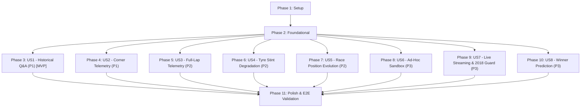

# Tasks: PitWall AI — F1 Race Engineer

**Input**: Design documents from `/specs/001-pitwall-ai/` ([spec.md](spec.md), [plan.md](plan.md), [data-model.md](data-model.md), [research.md](research.md), [contracts/api-contracts.md](contracts/api-contracts.md), [quickstart.md](quickstart.md))

**Prerequisites**: [plan.md](plan.md), [spec.md](spec.md), [data-model.md](data-model.md), [contracts/api-contracts.md](contracts/api-contracts.md), [constitution.md](../../.specify/memory/constitution.md)

**Tests**: Automated pytest and Playwright tests are mandatory per Constitution Principle V and the feature specification.

**Organization**: Tasks are grouped by user story to enable independent implementation and testing of each story.

## Format: `[ID] [P?] [Story] Description`

- **[P]**: Can run in parallel (different files, no dependencies on incomplete tasks)
- **[Story]**: Which user story this task belongs to (e.g., US1, US2...); omitted for Setup, Foundational, and Polish phases
- Every task includes explicit target file paths and resolving citations to `data-model.md` entities/fields where constrained data is handled

---

## Phase 1: Setup (Shared Infrastructure)

**Purpose**: Project initialization, environment setup, and dependency configuration across backend and frontend

- [X] T001 Initialize backend Python 3.12 project structure, virtual environment, and dependency manifest in `backend/requirements.txt` and `backend/pyproject.toml`
- [X] T002 [P] Initialize frontend React + TypeScript + Vite project with Tailwind CSS and dependencies in `frontend/package.json`, `frontend/vite.config.ts`, `frontend/tsconfig.json`, and `frontend/tailwind.config.ts`
- [X] T003 [P] Configure backend test harness and shared pytest fixtures in `backend/tests/conftest.py`
- [X] T004 [P] Configure frontend Playwright test configuration in `frontend/playwright.config.ts`
- [X] T005 [P] Create application configuration module managing environment variables, FastF1 cache path, DuckDB file path, and Gemini API keys in `backend/app/config.py`

---

## Phase 2: Foundational (Blocking Prerequisites)

**Purpose**: Core data ingestion, authentication, routing, and shared UI shell that MUST be complete before ANY user story can begin

**⚠️ CRITICAL**: No user story work can begin until this foundational phase is complete.

- [X] T006 Implement DuckDB manager with Kaggle CSV ingestion logic converting `\N` sentinels to `NULL` for all tables in `backend/app/data/duckdb_manager.py` (cites `data-model.md`: `circuits.circuitId`, `circuits.name`, `constructors.constructorId`, `constructors.name`, `drivers.driverId`, `drivers.forename`, `races.raceId`, `races.round`, `races.name`, `races.date`, `results.resultId`, `results.points`, `results.laps`, `qualifying.qualifyId`, `lap_times.raceId`, `pit_stops.raceId`, `driver_standings.driverStandingsId`, `constructor_standings.constructorStandingsId`, `status.statusId`)
- [X] T007 [P] Create curated read-only DuckDB SQL views (`v_race_results`, `v_qualifying`, `v_pit_stops`, `v_driver_standings`, `v_constructor_standings`) in `backend/app/data/views.py` (cites `data-model.md`: `v_race_results`, `v_qualifying`, `v_pit_stops`, `v_driver_standings`, `v_constructor_standings`)
- [X] T008 [P] Implement read-only SQL guardrail validator rejecting all mutating statements (INSERT, UPDATE, DELETE, DROP, ALTER) in `backend/app/data/duckdb_manager.py`
- [X] T009 [P] Initialize FastF1 disk cache manager with cache-first fallback and retry helper in `backend/app/data/fastf1_cache.py` (cites `data-model.md`: FastF1 cache `./data/fastf1_cache`)
- [X] T010 [P] Implement curated corner nickname mapping loader in `backend/app/data/entity_resolver.py` parsing `backend/data/corner_nicknames.json` (cites `data-model.md`: `Corner.turn_number`, `Corner.distance_m`, `Corner.nickname`, `Corner.circuit_key`)
- [X] T011 Implement fuzzy driver and circuit entity resolver matching name variants to canonical driver codes and circuit IDs in `backend/app/data/entity_resolver.py` (cites `data-model.md`: `drivers.code`, `drivers.surname`, `circuits.circuitRef`)
- [X] T012 Implement JWT authentication service, password hashing, and user dependencies in `backend/app/auth/dependencies.py` and router in `backend/app/auth/router.py` (cites `data-model.md`: `UserAccount.user_id`, `UserAccount.email`, `UserAccount.password_hash`, contracts: `POST /api/auth/login`, `POST /api/auth/register`)
- [X] T013 [P] Implement in-memory conversation session context manager with rolling summary + last 4–6 verbatim turns in `backend/app/chat/session.py` (cites `data-model.md`: `ConversationSession.session_id`, `ConversationSession.rolling_summary`, `ConversationSession.recent_turns`)
- [X] T014 [P] Implement SSE event formatting helpers (`session`, `status`, `text`, `chart`, `trace`, `error`, `done`) in `backend/app/chat/streaming.py` (cites `contracts/api-contracts.md`: SSE Event Type Summary)
- [X] T015 Implement dark HUD Plotly template with base `#0B0F17` background and WCAG AA contrast styling in `backend/app/charts/plotly_theme.py`
- [X] T016 Setup FastAPI application with CORS, exception handlers, health endpoint `GET /api/health`, and authentication middleware in `backend/app/main.py` (cites `contracts/api-contracts.md`: `GET /api/health`)

**Checkpoint**: Foundation ready — database loaded, auth working, FastF1 cache configured, streaming foundation ready. User story implementation can now begin.

---

## Phase 3: User Story 1 - Historical F1 Question Answering (Priority: P1) 🎯 MVP

**Goal**: Enable users to ask natural-language questions about 1950–2024+ F1 history and receive answers grounded in DuckDB SQL queries with interactive Plotly charts/tables and an Engineering Trace.

**Independent Test**: Query "Who won the 2023 Bahrain Grand Prix?" and "Show me Lewis Hamilton's podium finishes per season"; verify results against FIA records with 100% mathematical fidelity and inspect exact DuckDB SQL in Engineering Trace.

### Tests for User Story 1

- [X] T017 [P] [US1] Create pytest suite for DuckDB ingestion and `\N` to `NULL` normalization in `backend/tests/test_duckdb_ingestion.py`
- [X] T018 [P] [US1] Create pytest suite for read-only SQL guardrails and injection rejection in `backend/tests/test_sql_guardrails.py`
- [X] T019 [P] [US1] Create integration test for historical query tool execution in `backend/tests/test_historical_tool.py`

### Implementation for User Story 1

- [X] T020 [P] [US1] Implement DuckDB historical SQL query execution tool with timeout and read-only enforcement in `backend/app/agent/tools/historical_sql.py` (cites `data-model.md`: `races.year`, `results.position`, `v_race_results`, `v_driver_standings`)
- [X] T021 [P] [US1] Implement historical chart builders for bar, line, and classification tables with `#0B0F17` theme in `backend/app/charts/historical_charts.py`
- [X] T022 [US1] Implement Google ADK orchestrator agent in `backend/app/agent/orchestrator.py` and `backend/app/agent/prompts/system.py`: configure primary `gemini-3.5-flash-lite` (`thinking_level="low"`/`"medium"`, no deprecated parameters), local Ollama fallback via `LiteLlm(model="ollama_chat/qwen3.5:4b")` with context trimmed to last 2 turns, `asyncio.Semaphore(3)` concurrency guard, and response caching for repeated/preset prompts
- [X] T023 [US1] Connect SSE streaming chat endpoint `POST /api/chat/stream` for historical Q&A in `backend/app/chat/router.py` (cites `contracts/api-contracts.md`: `POST /api/chat/stream`)
- [X] T024 [P] [US1] Implement frontend authentication page and login hook in `frontend/src/components/Auth/LoginPage.tsx` and `frontend/src/hooks/useAuth.ts`
- [X] T025 [P] [US1] Implement dark HUD layout shell with left chat panel and right chart stage in `frontend/src/App.tsx`, `frontend/src/styles/globals.css`, and `frontend/src/types/index.ts`
- [X] T026 [US1] Implement chat UI with message list and streaming status indicator in `frontend/src/components/ChatPanel/ChatPanel.tsx`, `frontend/src/components/ChatPanel/MessageBubble.tsx`, and `frontend/src/hooks/useSSEStream.ts`
- [X] T027 [US1] Implement interactive Plotly stage and collapsible Engineering Trace drawer in `frontend/src/components/ChartStage/ChartStage.tsx`, `frontend/src/components/ChartStage/PlotlyChart.tsx`, and `frontend/src/components/EngineeringTrace/TraceDrawer.tsx`

**Checkpoint**: User Story 1 is fully functional as an MVP. Users can sign in, submit historical queries, see interactive charts, and inspect SQL traces.

---

## Phase 4: User Story 2 - Corner-by-Corner Telemetry Comparison (Priority: P1)

**Goal**: Compare two drivers through a specific corner (by turn number or nickname like Copse/Eau Rouge) with synchronized multi-panel telemetry (Speed, Delta, Throttle, Brake, Gear), zoomed GPS mini-map, and grounded race-engineer commentary.

**Independent Test**: Submit "Compare Verstappen and Leclerc through Copse at the 2024 British GP Qualifying" and verify braking point delta, apex min speed, lowest gear, full-throttle pickup, and corner time delta against FastF1 calculations.

### Tests for User Story 2

- [ ] T028 [P] [US2] Create unit test suite for fuzzy entity resolver (drivers, circuits, corner nicknames) in `backend/tests/test_entity_resolver.py`
- [ ] T029 [P] [US2] Create integration test suite for 1-meter interpolation and ±200m corner slicing math using cached 2024 British GP Qualifying fixture in `backend/tests/test_corner_slicing.py`

### Implementation for User Story 2

- [ ] T030 [P] [US2] Implement telemetry data loader with 1-meter spatial distance interpolation using `scipy`/`numpy` in `backend/app/agent/tools/telemetry.py` (cites `data-model.md`: `TelemetryLap.Distance`, `TelemetryLap.Speed`, `TelemetryLap.Throttle`, `TelemetryLap.Brake`, `TelemetryLap.nGear`, `TelemetryLap.RPM`, `TelemetryLap.DRS`, `TelemetryLap.X`, `TelemetryLap.Y`, `TelemetryLap.Z`)
- [ ] T031 [P] [US2] Implement dynamic team color resolver querying `fastf1.plotting.get_team_color()` for season with contrast validation against `#0B0F17` in `backend/app/charts/plotly_theme.py` (cites `data-model.md`: `SessionMetadata.team_color`)
- [ ] T032 [US2] Implement corner slicing tool calculating the 5 corner metrics (braking point delta, apex min speed, lowest gear, full-throttle pickup, corner time delta) across ±200m in `backend/app/agent/tools/corner_compare.py` (cites `data-model.md`: Computed Corner Metrics)
- [ ] T033 [US2] Implement multi-panel synchronized Plotly chart builder (Speed, Delta, Throttle, Brake, Gear) and GPS track coordinate builder in `backend/app/charts/telemetry_charts.py`
- [ ] T034 [P] [US2] Implement session and lap metadata extraction (GP name, year, session type, lap number, driver code, compound, weather) in `backend/app/agent/tools/telemetry.py` (cites `data-model.md`: `SessionMetadata.event_name`, `SessionMetadata.year`, `SessionMetadata.session_type`, `SessionMetadata.driver_code`, `SessionMetadata.compound`)
- [ ] T035 [US2] Register corner comparison tool in Google ADK agent with race-engineer commentary prompt grounded in computed metrics in `backend/app/agent/orchestrator.py` and `backend/app/agent/prompts/system.py`
- [ ] T036 [US2] Connect corner comparison tool execution and trace payload emission in `backend/app/chat/router.py` (cites `contracts/api-contracts.md`: `event: trace` with `telemetry_params`)
- [ ] T037 [P] [US2] Implement session metadata bar component in `frontend/src/components/MetadataBar/MetadataBar.tsx`
- [ ] T038 [P] [US2] Implement zoomed GPS track mini-map component colored by faster driver in `frontend/src/components/ChartStage/TrackMiniMap.tsx`
- [ ] T039 [US2] Enhance frontend Plotly chart stage to support synchronized multi-panel telemetry charts and tooltips in `frontend/src/components/ChartStage/PlotlyChart.tsx`
- [ ] T040 [US2] Add preset prompts for famous corners (Copse, Eau Rouge, 130R) in `frontend/src/components/ChatPanel/PresetPrompts.tsx`

**Checkpoint**: User Stories 1 and 2 both work independently. Users can seamlessly transition from historical statistics to deep corner-by-corner telemetry analysis.

---

## Phase 5: User Story 3 - Full-Lap Telemetry Overlay (Priority: P2)

**Goal**: Overlay two drivers' full-lap telemetry traces across an entire lap with official team colors, delta trace, and sector splits.

**Independent Test**: Request "Overlay Verstappen vs Hamilton full lap at 2023 Abu Dhabi Qualifying" and confirm speed trace matches FastF1 lap data across 100% of lap distance.

### Tests for User Story 3

- [ ] T041 [P] [US3] Create integration test for full-lap telemetry alignment and speed delta computation in `backend/tests/test_full_lap.py`

### Implementation for User Story 3

- [ ] T042 [P] [US3] Implement full-lap telemetry extraction tool in `backend/app/agent/tools/telemetry.py` (cites `data-model.md`: `TelemetryLap.Speed`, `TelemetryLap.Distance`, `SessionMetadata.lap_time`)
- [ ] T043 [US3] Implement full-lap Plotly chart builder with speed overlay, delta trace, and gear application in `backend/app/charts/telemetry_charts.py`
- [ ] T044 [US3] Register full-lap overlay tool in Google ADK orchestrator in `backend/app/agent/orchestrator.py`
- [ ] T045 [US3] Add missing-lap error handling for drivers without valid timed laps in `backend/app/agent/tools/telemetry.py`
- [ ] T046 [US3] Wire full-lap chart and trace event emission through `POST /api/chat/stream` in `backend/app/chat/router.py`
- [ ] T047 [P] [US3] Update frontend `frontend/src/components/ChartStage/PlotlyChart.tsx` to handle full-lap multi-channel zoom and pan interactions
- [ ] T048 [P] [US3] Add full-lap comparison preset prompts in `frontend/src/components/ChatPanel/PresetPrompts.tsx`

**Checkpoint**: User Story 3 complete and verified independently alongside US1 and US2.

---

## Phase 6: User Story 4 - Tyre Stint Degradation Analysis (Priority: P2)

**Goal**: Analyze tyre degradation per stint during a race, filtering out pit-in/pit-out laps and Safety Car periods, with compound-colored traces and linear degradation trend lines.

**Independent Test**: Request "Show me Verstappen's tyre degradation at the 2023 Spanish GP" and verify pit/Safety Car laps are excluded and degradation rate (sec/lap) matches timing data.

### Tests for User Story 4

- [ ] T049 [P] [US4] Create unit test for pit and Safety Car lap filtering in `backend/tests/test_strategy.py`

### Implementation for User Story 4

- [ ] T050 [P] [US4] Implement stint extraction and outlier filtering tool in `backend/app/agent/tools/strategy.py` (cites `data-model.md`: `Stint`, `lap_times.lap`, `lap_times.milliseconds`, `SessionMetadata.compound`)
- [ ] T051 [US4] Implement linear regression degradation trend line calculation per stint using NumPy in `backend/app/agent/tools/strategy.py`
- [ ] T052 [US4] Implement tyre stint degradation Plotly scatter + line chart builder colored by compound in `backend/app/charts/strategy_charts.py`
- [ ] T053 [US4] Handle red-flagged races and multi-part stints in `backend/app/agent/tools/strategy.py`
- [ ] T054 [US4] Register tyre stint analysis tool in Google ADK agent in `backend/app/agent/orchestrator.py`
- [ ] T055 [US4] Wire tyre degradation events through SSE stream in `backend/app/chat/router.py`
- [ ] T056 [P] [US4] Add tyre degradation presets and compound legend support in `frontend/src/components/ChatPanel/PresetPrompts.tsx` and `frontend/src/components/ChartStage/PlotlyChart.tsx`

**Checkpoint**: User Story 4 functional; race strategy insights available with clean lap-time filtering.

---

## Phase 7: User Story 5 - Race Position Evolution (Priority: P2)

**Goal**: Render a comprehensive "spaghetti plot" showing lap-by-lap position evolution for all drivers in a Grand Prix, annotated with pit stops, retirements, and Safety Cars.

**Independent Test**: Request "Show me the race position chart for the 2023 Brazilian GP" and verify position lines, pit-stop markers, and DNF statuses against official race classification.

### Tests for User Story 5

- [ ] T057 [P] [US5] Create integration test for race position evolution data extraction in `backend/tests/test_position_evolution.py`

### Implementation for User Story 5

- [ ] T058 [P] [US5] Implement lap-by-lap position extraction tool querying `lap_times` and `pit_stops` in `backend/app/agent/tools/strategy.py` (cites `data-model.md`: `lap_times.position`, `lap_times.lap`, `pit_stops.lap`, `results.positionText`, `status.status`)
- [ ] T059 [US5] Implement position evolution Plotly chart builder with driver line highlights and pit-stop markers in `backend/app/charts/strategy_charts.py`
- [ ] T060 [US5] Register race position evolution tool in Google ADK orchestrator in `backend/app/agent/orchestrator.py`
- [ ] T061 [US5] Wire position evolution chart and trace emissions in `backend/app/chat/router.py`
- [ ] T062 [P] [US5] Implement interactive driver line highlighting on hover/click in `frontend/src/components/ChartStage/PlotlyChart.tsx`
- [ ] T063 [P] [US5] Add race position evolution preset buttons in `frontend/src/components/ChatPanel/PresetPrompts.tsx`
- [ ] T064 [US5] Display event annotations (SC, VSC, Red Flag) on position chart in `frontend/src/components/ChartStage/PlotlyChart.tsx`

**Checkpoint**: User Story 5 functional; full-race position flow visualizable with interactive team-line isolation.

---

## Phase 8: User Story 6 - Ad-Hoc Cross-Metric Analysis (Priority: P3)

**Goal**: Handle custom cross-metric analytical questions not covered by preset charts via a restricted, timeout-guarded Python sandbox returning interactive Plotly figures with explicit computation traces.

**Independent Test**: Submit "Plot average pit stop duration per team across the last 5 seasons" and verify generated Python code executes sandboxed without filesystem/network access and returns a valid Plotly chart.

### Tests for User Story 6

- [ ] T065 [P] [US6] Create unit test suite for Python sandbox security restrictions (blocking `open`, `os`, `socket`, `subprocess`, enforcing timeout) in `backend/tests/test_sandbox.py`

### Implementation for User Story 6

- [ ] T066 [US6] Implement timeout-guarded restricted Python execution sandbox in `backend/app/sandbox/executor.py`
- [ ] T067 [US6] Implement ad-hoc Python execution tool injecting read-only DuckDB connection and Plotly figure exporter in `backend/app/agent/tools/adhoc_sandbox.py`
- [ ] T068 [US6] Configure LLM system prompt instructions for generating safe ad-hoc Python data analysis code in `backend/app/agent/prompts/system.py`
- [ ] T069 [US6] Register ad-hoc sandbox tool in Google ADK agent in `backend/app/agent/orchestrator.py`
- [ ] T070 [US6] Wire ad-hoc Python code into trace event payload in `backend/app/chat/router.py` (cites `contracts/api-contracts.md`: `trace.python_code`)
- [ ] T071 [P] [US6] Render generated Python code in Engineering Trace drawer with copy-to-clipboard affordance in `frontend/src/components/EngineeringTrace/TraceDrawer.tsx`
- [ ] T072 [US6] Handle cross-domain labeling when ad-hoc analysis combines historical SQL and FastF1 telemetry in `backend/app/agent/tools/adhoc_sandbox.py` and `frontend/src/components/EngineeringTrace/TraceDrawer.tsx`

**Checkpoint**: User Story 6 complete; ad-hoc analytics safely supported without opening system-level vulnerabilities.

---

## Phase 9: User Story 7 - Live Progress Streaming & 2018 Boundary Explanation (Priority: P3)

**Goal**: Stream real-time step-by-step tool progress messages to the UI during long computations and gracefully explain the 2018 data boundary when pre-2018 telemetry is requested.

**Independent Test**: Submit "Show me Schumacher's telemetry at the 2004 Italian GP" and verify boundary explanation with historical alternatives; submit a corner comparison and observe progress events streaming before chart displays.

### Tests for User Story 7

- [ ] T073 [P] [US7] Create unit test for 2018 boundary guardrail and explanation generator in `backend/tests/test_boundary_guard.py`

### Implementation for User Story 7

- [ ] T074 [US7] Implement 2018 boundary check intercepting pre-2018 telemetry queries and offering historical SQL alternatives in `backend/app/agent/tools/telemetry.py` (cites `data-model.md`: `Validation Rules: Telemetry Year Boundary`)
- [ ] T075 [US7] Implement granular progress callback hooks across DuckDB queries and FastF1 download stages in `backend/app/chat/streaming.py` and `backend/app/agent/orchestrator.py`
- [ ] T076 [US7] Stream step-by-step progress events over SSE during tool execution in `backend/app/chat/router.py` (cites `contracts/api-contracts.md`: `event: status`)
- [ ] T077 [P] [US7] Implement live progress status drawer/toast in `frontend/src/components/ChatPanel/StreamingStatus.tsx`
- [ ] T078 [US7] Render 2018 boundary explanation with clickable quick-pivot buttons for historical stats in `frontend/src/components/ChatPanel/MessageBubble.tsx`
- [ ] T079 [P] [US7] Implement transient timeout retry indicator in `frontend/src/components/ChatPanel/StreamingStatus.tsx`
- [ ] T080 [US7] Add SSE connection error handling and automatic reconnection logic in `frontend/src/hooks/useSSEStream.ts`

**Checkpoint**: User Story 7 functional; user feedback is responsive and data domain boundaries are clear.

---

## Phase 10: User Story 8 - Winner Prediction (Priority: P3)

**Goal**: Provide grounded race winner and championship predictions based on recent driver/team form, qualifying pace, and circuit history with explicit confidence factors and traceable statistics.

**Independent Test**: Request "Who will win the next race at Silverstone?" and verify prediction output lists ranked candidates, percentage confidence, and every cited stat traces to a DuckDB query in the Engineering Trace.

### Tests for User Story 8

- [ ] T081 [P] [US8] Create unit test for deterministic prediction score calculation and factor traceability in `backend/tests/test_prediction.py`

### Implementation for User Story 8

- [ ] T082 [P] [US8] Implement recent form and circuit history aggregator querying DuckDB in `backend/app/agent/tools/prediction.py` (cites `data-model.md`: `v_race_results`, `v_qualifying`, `races.year`, `circuits.circuitId`)
- [ ] T083 [US8] Implement deterministic weighted ranking algorithm calculating win probabilities and confidence scores in `backend/app/agent/tools/prediction.py`
- [ ] T084 [US8] Implement prediction breakdown Plotly horizontal bar chart showing factor contributions in `backend/app/charts/historical_charts.py`
- [ ] T085 [US8] Register winner prediction tool in Google ADK orchestrator in `backend/app/agent/orchestrator.py`
- [ ] T086 [US8] Wire prediction factor queries into Engineering Trace payload in `backend/app/chat/router.py`
- [ ] T087 [P] [US8] Implement confidence score badges and factor breakdown display in `frontend/src/components/ChatPanel/MessageBubble.tsx`
- [ ] T088 [P] [US8] Add prediction prompt presets for upcoming and historic circuits in `frontend/src/components/ChatPanel/PresetPrompts.tsx`

**Checkpoint**: User Story 8 functional; data-driven predictions available without parametric LLM hallucination.

---

## Phase 11: Polish & Cross-Cutting Concerns

**Purpose**: End-to-end integration validation, performance tuning, and Playwright verification

- [ ] T089 [P] Implement end-to-end Playwright smoke test verifying authentication, chat interaction, and Plotly rendering with zero console errors in `frontend/tests/smoke.spec.ts`
- [ ] T090 [P] Validate WCAG AA contrast ratio (4.5:1 minimum) across all chart text and UI elements against `#0B0F17` in `frontend/src/styles/globals.css`
- [ ] T091 Execute full backend pytest suite validating scenarios V1 through V5 and V7 from quickstart guide in `backend/tests/`
- [ ] T092 Verify FastF1 disk cache re-use and offline capability on cached sessions in `backend/app/data/fastf1_cache.py`
- [ ] T093 Conduct concurrency stress test simulating 5–10 concurrent sessions in `backend/tests/test_concurrency.py`
- [ ] T094 [P] Verify responsiveness across desktop and laptop display viewports in `frontend/src/App.tsx`
- [ ] T095 Code cleanup, dead code elimination, and type check verification across backend and frontend
- [ ] T096 Run complete verification workflow per `specs/001-pitwall-ai/quickstart.md`

---

## Dependencies & Execution Order

### Phase Dependencies

### User Story Dependencies

- **US1 (Historical Q&A - P1)**: Depends only on Phase 2 (DuckDB, auth, basic chat UI). Independent of all telemetry stories.
- **US2 (Corner Telemetry - P1)**: Depends on Phase 2 (FastF1 cache, entity resolver, Plotly stage). Can run in parallel with US1.
- **US3 (Full-Lap Telemetry - P2)**: Reuses telemetry loading from US2 (T030) and Plotly stage.
- **US4 (Tyre Degradation - P2)**: Reuses FastF1 session data and DuckDB stint definitions. Independent of corner slicing.
- **US5 (Position Evolution - P2)**: Reuses DuckDB `lap_times` and team colors from Phase 2. Independent of telemetry.
- **US6 (Ad-Hoc Sandbox - P3)**: Reuses DuckDB connection and Plotly theme. Independent of specific chart builders.
- **US7 (Live Streaming - P3)**: Hooks into SSE streaming pipeline established in Phase 2.
- **US8 (Prediction - P3)**: Reuses historical results querying from US1.

---

## Parallel Execution Opportunities

### Phase 1 & 2 Parallel Tracks
- `backend/requirements.txt` (T001) in parallel with `frontend/package.json` (T002)
- `duckdb_manager.py` (T006) in parallel with `fastf1_cache.py` (T009) and `entity_resolver.py` (T010)
- `auth/dependencies.py` (T012) in parallel with `chat/session.py` (T013) and `charts/plotly_theme.py` (T015)

### User Story 1 Parallel Track
- Tests (T017, T018, T019) written first
- Backend tools (T020, T021) in parallel with Frontend components (T024, T025)

### User Story 2 Parallel Track
- Entity resolver tests (T028) and corner slicing tests (T029) written first
- Telemetry loader (T030) and team color resolver (T031) in parallel with mini-map (T038) and metadata bar (T037)

---

## Implementation Strategy

### MVP First (Phases 1, 2, and 3)
1. Complete Phase 1 (Setup) and Phase 2 (Foundational).
2. Complete Phase 3 (User Story 1: Historical F1 Q&A).
3. **Validate MVP**: Run `pytest backend/tests/test_duckdb_ingestion.py` and test query "Who won the 2023 Bahrain Grand Prix?". At this point, the platform is already a viable, useful F1 analytics engine.

### Incremental Delivery
1. Add User Story 2 (Corner Telemetry) → Unlock signature race-engineer differentiator.
2. Add User Stories 3, 4, 5 (Full-Lap, Tyres, Position) → Complete full race weekend analysis suite.
3. Add User Stories 6, 7, 8 (Ad-hoc, Streaming, Predictions) → Complete advanced analytical suite.
4. Run Phase 11 (Polish & Playwright E2E) → Production ready.
